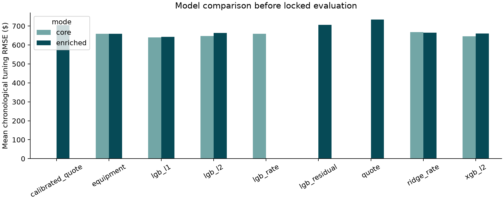
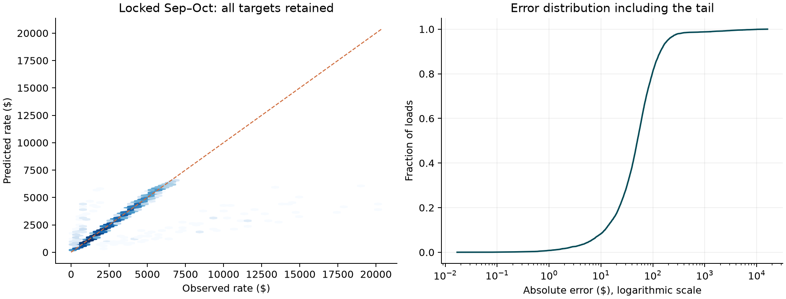
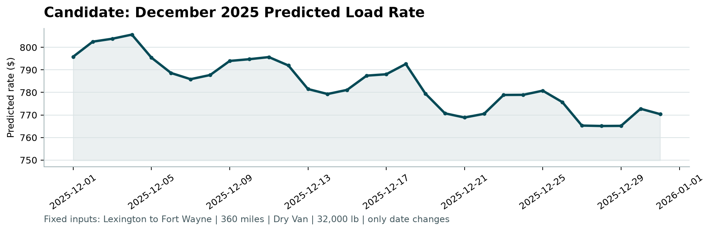

# Freight Rate Prediction

Validation design, measured results, and reproducible submission

## 1. Result and submission contract

The frozen enriched predictor achieved RMSE $633.77 and MAE $119.42 on 9,523 held-out September–October loads. These are internal chronological evaluation results, not the unknown Spotter hidden-test score. The final outputs contain all 12,000 requested IDs and all 31 fixed December dates. The unmodified supplied scorer accepted both files.

The submission uses the enriched model where quote signal is available. The December chart uses a separately trained and selected core model because its input omits quote signal, market index, and coordinates. This information difference is evaluated explicitly rather than hidden by filling privileged fields with arbitrary values.

## 2. Data exploration and quality decisions

| Property | Development | Prediction set |
| --- | --- | --- |
| Rows | 48,000 | 12,000 |
| Date coverage | Jan–Oct 2025 | Nov–Dec 2025 |
| Cities | 64 | 72 |
| Directed routes | 4014 | 4214 |
| Missing weights | 300 | 165 |
| Nonpositive weights | 292 | 145 |
| Missing market indices | 374 | 249 |
| Duplicate feature rows | 0 | 0 |

All 48,000 development targets are finite and positive. Missing and nonpositive physical features become missing values with explicit indicators; imputation medians are fitted only on historical training rows. Negative weights are not converted to absolute values. No finite positive target is removed or winsorized. The target range is $57.22–$25,533.00; large errors must therefore be assessed rather than discarded.

There are eight unseen prediction cities: Allentown, Charlotte, Chicago, Jackson, Knoxville, Laredo, Norfolk, San Diego. 1,461 prediction rows use routes absent from development. Categorical handling supports unknown values, and supplied numerical coordinates support geographic transfer. Historical city-coordinate pairs are internally consistent; external geocoding is not used because these are dataset-specific coordinates.

The simple quote-signal-times-distance diagnostic has a median absolute error of $55.55 but RMSE $674.57 across development. This gap motivates strong signal baselines, residual learning, and comparisons of absolute and squared loss. This whole-development descriptive diagnostic is not a validation score.

## 3. Plan critique and validation architecture

The initial generic baseline-plus-boosting plan was revised after inspecting actual date coverage and the December schema. A random split would mix future and past loads; a single enriched model would also be evaluated on inputs absent from the chart. The revised architecture separates enriched and core paths, uses complete calendar periods, and reserves a final untouched period. The initial sample, critique, full audit update, and runtime authorization are retained in docs/PLAN.md.

| Purpose | Training period | Evaluation period | Evaluation rows |
| --- | --- | --- | --- |
| Tune fold 1 | Jan–Apr | May–Jun | 9696 |
| Tune fold 2 | Jan–Jun | Jul–Aug | 9671 |
| Locked evaluation | Jan–Aug | Sep–Oct | 9523 |
| Submission refit | Jan–Oct | Nov–Dec (unlabeled) | 12,000 |

Each boosting fit first selects its iteration count on the last month inside that fit’s training history, then refits on the full training history. Outer tuning or locked evaluation labels never set early-stopping rounds. Category vocabularies, city maps, medians, scalers, and encoders are fitted inside the corresponding training partition. Exact feature duplicates crossing a boundary are purged from fitting; none were found. Load IDs are never model features.

Because the assessment does not specify the hidden ranking metric, the provisional primary criterion is the unweighted mean of the two tuning-fold RMSE values in dollars. MAE, WAPE, R-squared, and bias are also recorded. The blend grid contains only 25%, 50%, and 75% weights for each candidate pair, plus individual models. Selections are written before September–October predictions are evaluated. The final window is not used for model or blend reselection.

## 4. Features and model comparison

Features include pickup and delivery categories, directed route, equipment, cleaned distance and weight, distance transforms, weight per mile, coordinate deltas and distance, and missing/invalid indicators. Calendar features include weekly and annual sine/cosine terms, weekend and month-boundary flags. The enriched path adds quote signal, quote times distance, market index, and simple interactions. The core path reconstructs coordinates solely from its fitted historical city map and ignores all extra input fields, even when they are supplied by the caller.

Candidates include an equipment-specific median rate-per-mile baseline; quote times distance and affine quote calibration; a regularized, distance-weighted ridge rate-per-mile model; LightGBM with squared and absolute loss; quote-residual LightGBM; core rate-per-mile LightGBM; and XGBoost. The rate-per-mile models use squared-distance weights so their squared-error objective corresponds to dollar squared error. No unconstrained hyperparameter search, external weather data, unverified holiday effects, or target encoding is used.

| Input mode / model | Mean RMSE | Mean MAE |
| --- | --- | --- |
| core / lgb_l1 | $639.44 | $156.51 |
| core / xgb_l2 | $646.09 | $173.14 |
| core / lgb_l2 | $647.97 | $170.62 |
| core / lgb_rate | $658.36 | $180.71 |
| core / equipment | $658.53 | $214.46 |
| core / ridge_rate | $668.58 | $231.33 |
| enriched / lgb_l1 | $643.01 | $145.81 |
| enriched / equipment | $658.53 | $214.46 |
| enriched / xgb_l2 | $660.98 | $197.46 |
| enriched / lgb_l2 | $663.28 | $200.07 |
| enriched / ridge_rate | $665.66 | $228.22 |
| enriched / calibrated_quote | $704.63 | $272.87 |
| enriched / lgb_residual | $705.98 | $285.74 |
| enriched / quote | $733.65 | $306.28 |

Frozen enriched selection: 25% equipment + 75% lgb_l1. Frozen core selection: 25% equipment + 75% lgb_l1. These are the best configurations in the declared candidate/blend search under the tuning criterion, not a claim of globally optimal accuracy.

## 5. Locked evaluation and transfer diagnostics

| Predictor | RMSE | MAE | WAPE | R-squared |
| --- | --- | --- | --- | --- |
| enriched | $633.77 | $119.42 | 4.99% | 0.8275 |
| core | $631.04 | $113.77 | 4.76% | 0.8290 |
| quote_baseline | $711.80 | $246.02 | 10.28% | 0.7824 |

| Segment | Loads | RMSE | MAE |
| --- | --- | --- | --- |
| Dry Van | 5360 | $654.97 | $115.58 |
| Flatbed | 1770 | $506.93 | $114.61 |
| Reefer | 2393 | $668.94 | $131.57 |
| seen | 9502 | $634.47 | $119.58 |
| unseen | 21 | $49.52 | $44.98 |
| above_training_p99 | 101 | $5,699.12 | $3,554.19 |
| at_or_below_training_p99 | 9422 | $240.41 | $82.60 |

A separate transfer stress test removes all training routes touching eight deterministically selected cities, then scores future loads touching those cities. It retains 29,402 training rows and evaluates 2,288 future rows. Enriched RMSE is $545.00; core RMSE is $556.56. This is a sensitivity diagnostic, not an additional selection fold or an estimate of performance for the specific eight unseen submission cities.

## 6. Fixed December chart

The chart below is generated by the supplied score.py without modifications. All inputs are fixed to Lexington → Fort Wayne, 360 miles, Dry Van, and 32,000 lb; only the date varies across December 2025. Original input CSVs remain unchanged. Predictions range from $765.12 to $805.66. The same frozen core-model recipe evaluated above is refitted on all labeled history before generating these values.

December has no labeled development observations. Smooth cyclic features permit extrapolation, but the chart is not proof that December seasonality was learned correctly. Core validation measures the information-restricted problem across many loads; it does not provide ground truth for this exact fixed lane. The chart is a point prediction, not a confidence interval or a fabricated holiday scenario.

## 7. Reproduction, architecture, and limitations

freight/data.py validates schemas and data quality; freight/features.py owns fitted cleaning and features; freight/models.py implements candidates and inner early stopping; freight/evaluation.py scores folds, selects blends, and computes slices; run.py freezes the experiment sequence and writes predictions. scripts/predict.py regenerates both prediction files from the trusted local model bundle. scripts/make_report.py generates this report and the video script from saved evidence.

Run in the existing conda ml environment. Execute python run.py --device cpu --threads 6, then python -m scripts.make_report. The default CUDA request has a CPU fallback; the actual backend is recorded. Checkpoints use atomic replacement, stage-completion markers, source/configuration/data hashes, and trusted local pickle files. Matching completed tasks can resume. No Kaggle or Hugging Face service is required for this local workflow.

The recorded modeling pipeline took 70.7 seconds in this environment, excluding development, report creation, and setup. Earlier runtime estimates were conservative; this compact search and early stopping were substantially faster. GPU hardware was visible, but the installed XGBoost runtime fell back to CPU during the initial CUDA attempt. The finalized reproducible run uses CPU and six threads. Exact library versions and data/source hashes are saved in artifacts/manifest.json.

Limitations: the hidden test labels and ranking metric are unavailable; there is only one year of partial history; future city and market distributions differ; rare high-rate loads dominate squared error; quote and market feature provenance is not documented; and no prediction intervals are claimed. Using quote signal assumes it is available at quote time, as it is in the provided prediction file. This assumption requires business confirmation before deployment. No score improvement on the hidden test set can be asserted.

Submission files: submission/validation_predictions.csv and submission/december_predictions.csv. Report: reports/freight_rate_report.pdf or .docx. Video narration: reports/video_script.md. Repository: https://github.com/Mveen3/spotter-ai-assessment. The scorer validates output contracts and plots rates; its success is distinct from model accuracy.

Method references: scikit-learn chronological validation documentation (https://scikit-learn.org/stable/modules/cross_validation.html); LightGBM parameters (https://lightgbm.readthedocs.io/en/stable/Parameters.html); XGBoost Python API (https://xgboost.readthedocs.io/en/stable/python/python_api.html).
